# Architecture Specification: Local Economy Resilience Agent
**Corridor**: San Francisco — Central Market  
**Track**: Micro-Producer & Supply Continuity  
**Target Dataset**: `qwiklabs-gcp-03-14e29f4c8c1f.a4i_econ`  
**Framework**: Google Agent Development Kit (ADK), BigQuery Property Graphs (GQL), & MCP Toolbox for Databases

---

## 1. Executive Summary & Design Premise

The **Local Economy Resilience Agent** functions as an AI Economic Development Officer allocating a fixed **$50,000 Micro-Grant Resilience Fund** across Central Market commercial entities.

### Core Axioms
1. **"A graph makes consequence visible; it does not make the decision."**
2. **Prioritization, not Prediction**: The agent prioritizes *"who to investigate first and why"*, explicitly accounting for unobserved contracts, cash reserves, and inventory buffers.
3. **Guard Against Circularity**: Historical loan charge-offs serve strictly as an out-of-sample ground-truth validator; they are never fed into the topological grant sizing calculation.
4. **Resilience Sweet Spot (5–25 Exposed)**: Mitigates giant hub bias (ubiquitous broadline vendors >25 connections that are readily substitutable) and trivial leaves (<5 connections).
5. **Path-Intensity Weighting**: Paths are evaluated not merely by discrete hop counts, but by compound input intensities $\prod_{e \in p} \text{intensity}(e)$ and customer reliance.

---

## 2. System Architecture & Topology

```mermaid
flowchart TD
    subgraph Client & Presentation Layer
        User[Grant Officer]
        WebUI[ADK Web Console / Studio]
        CLI[ADK Interactive Shell]
    end

    subgraph ADK Agent Layer [agent/agent.py]
        Agent[ADK Root Agent: resilience_grant_agent]
        Model[Gemini 2.5 Flash]
        Agent --- Model
    end

    subgraph MCP Integration Layer
        MCPToolbox[Google MCP Toolbox for Databases]
        ToolsConfig[agent/tools.yaml]
        MCPToolbox --- ToolsConfig
    end

    subgraph Tool & Decision Layer [agent/tools.py]
        T_Disc[discover_priority_candidates: GQL 5-25 Sweet Spot]
        T_Casc[query_cascade_exposure: Bidirectional GQL + Reliance]
        T_Eval[evaluate_grant_recommendation: Non-circular Topology Sizing]
        T_Port[allocate_portfolio_grants: $50K Budget & Runner-ups]
        T_SBA[validate_sba_ground_truth: Seasoned CA Credit Benchmarks]
        T_Foot[assess_footfall_commuter_exposure: LEHD DrawsFootfall]
        T_Equit[audit_corridor_equity_and_portfolio_bias: ACS Demographics]
        T_Log[write_grant_decision: BigQuery Audit Trail]
    end

    subgraph BigQuery Data Tier [a4i_econ]
        subgraph Property Graph: LocalEconomy
            G_Biz[(Business Node: businesses - 231)]
            G_Emp[(Employer Node: employer_blocks - 122)]
            G_Sup{{Supplies Edge: supplies - 989}}
            G_Foot{{DrawsFootfall Edge: draws_footfall_from - 1024}}
            G_Biz -->|Supplies: intensity, metres| G_Biz
            G_Emp -->|DrawsFootfall: worker_share, metres| G_Biz
        end

        subgraph Relational Tables
            T_Loans[(borrowed_from: SBA 7a/504)]
            T_Tracts[(tract_demographics: Census ACS)]
            T_Decs[(grant_decisions: Audit Table)]
        end
    end

    User <--> WebUI
    User <--> CLI
    WebUI <--> Agent
    CLI <--> Agent
    Agent <--> MCPToolbox
    Agent --> T_Disc
    Agent --> T_Casc
    Agent --> T_Eval
    Agent --> T_Port
    Agent --> T_SBA
    Agent --> T_Foot
    Agent --> T_Equit
    Agent --> T_Log

    T_Disc -->|GQL NEXT/FILTER| LocalEconomy
    T_Casc -->|Bidirectional GQL| LocalEconomy
    T_Foot -->|SQL DrawsFootfall| LocalEconomy
    T_SBA -->|SQL Seasoned Join| T_Loans
    T_Equit -->|SQL Equity Benchmark| T_Tracts
    T_Log -->|INSERT DDL| T_Decs
```



---

## 3. Data Tier: Reality Matrix & Provenance Bounds

| Table / Element | Graph Role | Provenance & Ground Truth Status | Central Market Coverage & Reality Bounds |
|---|---|---|---|
| **`businesses`** | Node (`Business`) | **100% Real** (SF Registered Business Locations) | 231 businesses across 65 NAICS4 codes. |
| **`employer_blocks`** | Node (`Employer`) | **Real** jobs totals (Census LEHD LODES) | 122 blocks within walkable distance of corridor storefronts. |
| **`supplies`** | Edge (`Supplies`) | **Modeled** (BEA Input-Output matrix + distance filter) | 989 directed edges. Generator retains top 5 suppliers per buyer and drops 21 ubiquitous sectors. |
| **`draws_footfall_from`**| Edge (`DrawsFootfall`)| **Modeled** (Allocated commuter jobs) | 1,024 directed edges linking daytime workers to shops. |
| **`borrowed_from`** | Attribute (SQL Join) | **100% Real** (SBA FOIA 7(a)/504 records FY2020-present) | **Only 3 businesses matched (4 loans, ~1.3% coverage). Zero charge-offs in corridor.** |
| **`tract_demographics`** | Attribute (SQL Join) | **100% Real** (Census ACS 5-Year Estimates) | 7 census tracts covering Central Market corridor. |

---

## 4. Graph Semantics & Traversal Directions

In `create_graph.sql`, the directed edge `Supplies` is explicitly declared as:
```sql
SOURCE KEY (supplier_id) REFERENCES businesses (business_id)
DESTINATION KEY (buyer_id) REFERENCES businesses (business_id)
```
Therefore, all traversals strictly adhere to:
$$\text{Supplier} \xrightarrow{\text{Supplies}} \text{Buyer / Customer}$$

### 1. Forward Traversal: Direct Customers & Downstream Protection Cascade
* **Direct Customers (1-hop)**:
  $$(seed:Business) \xrightarrow{[:Supplies]} (customer:Business)$$
* **Downstream Protection Cascade (1-to-2 hops)**:
  $$(seed:Business) \xrightarrow{[:Supplies]\{1,2\}} (exposed:Business)$$
* **Customer Reliance Metric**: For each direct customer $c$, computes what proportion of their input intensity originates from the seed:
  $$\text{Reliance}(c) = \frac{\text{Intensity}(seed \to c)}{\sum_{s} \text{Intensity}(s \to c)}$$

### 2. Backward Traversal: Upstream Dependencies & Single-Point-of-Failure
* **Upstream Suppliers (1-hop)**:
  $$(supplier:Business) \xrightarrow{[:Supplies]} (seed:Business)$$
* **Single-Point-of-Failure Risk**: If `upstream_suppliers_count == 1`, the seed relies on a solitary corridor supplier for its key inputs, signaling critical operational supply vulnerability.

---

## 5. Tool Specifications & Status

| Tool Name | Status | Function & Algorithmic Design |
|---|---|---|
| **`discover_priority_candidates`** | **Built** | GQL query using `NEXT ... FILTER` for the 5–25 downstream exposed band. Checks corridor NAICS peer density to tag **generator artifacts** (sole registrants accumulating edges). |
| **`query_cascade_exposure`** | **Built** | Genuine bidirectional GQL traversal. Computes forward customer reliance, 2-hop exposed reach, upstream supplier dependencies, and continuous intensity score. |
| **`evaluate_grant_recommendation`**| **Built** | Non-circular grant sizing ($0 to $12,500). Prioritizes 5–25 sweet spot; penalizes substitutable hubs (>25 connections). |
| **`allocate_portfolio_grants`** | **Built** | Portfolio budget manager: distributes fixed $50,000 fund across candidates and designates runner-ups. |
| **`validate_sba_ground_truth`** | **Built** | Out-of-sample validator using seasoned California loan cohorts ($N \ge 30$) with NAICS4 $\to$ NAICS2 rollup. Discloses Central Market 1.3% match limit. |
| **`assess_footfall_commuter_exposure`**| **Built** | Traverses `DrawsFootfall` to quantify allocated daytime worker collapse risk. |
| **`audit_corridor_equity_and_portfolio_bias`**| **Built** | Evaluates entire funded cohort against corridor ACS poverty averages and checks food-service vs producer industry skew. |
| **`write_grant_decision`** | **Built** | Logs decisions with deterministic UUID4 `decision_id`, run IDs, and benchmark levels into BigQuery audit log. |

---

## 6. Ground-Truth Validation & Back-Test Protocol

### Central Market Coverage Reality
* In Central Market, **only 3 of 231 businesses (~1.3%)** have matched SBA loan records, and **zero loans were charged off**.
* **Zero historical failures in the corridor means Central Market cannot serve as its own back-test ground truth.**

### Cross-Corridor Back-Test Protocol
To prove that our network fragility score accurately correlates with real historical business failure:
1. The pipeline is executed against a historical test corridor with realized SBA charge-offs (e.g. *Mission District* or *North Beach*).
2. Applicants are scored blindly using only graph topology and customer reliance.
3. The fragility scores are back-tested against actual `charged_off = TRUE` labels to validate receiver operating characteristics (ROC) out of sample.

---

## 7. Grant Triage Memo Specification

Every recommendation generated by the agent outputs an audit-ready **Grant Triage Memo** adhering to this standard:

```markdown
### Micro-Grant Triage Memo
**Applicant**: [Business Name] (ID: [business_id], NAICS: [naics4] - [Industry Title])
**Corridor**: San Francisco — Central Market | **Census Tract**: [tract_id]

#### 1. Network Cascade & Protection Value
- **Direct Local Customers**: [N] businesses (Average Reliance: [X]%)
- **2-Hop Downstream Protected Venues**: [N] businesses
- **Continuous Cascade Score**: [Score] (intensity-weighted)
- **Top Downstream Buyers**: [Customer A] (weight: [W1]), [Customer B] (weight: [W2])
- **Upstream Supply Risk**: [N] suppliers (Single-Point-of-Failure: [YES/NO])

#### 2. Generator Artifact & Hub Assessment
- **Corridor Peer Density**: [N] registrants in NAICS [naics4].
- **Sole-Source Caveat**: [None / Generator Artifact: Sole local registrant; reach is upper bound].
- **Hub Status**: [Optimal Resilience Band (5-25) / Hub Penalty (>25)].

#### 3. Footfall & Commuter Exposure
- **Daytime Workers Allocated**: [N] workers from [B] workplace blocks.
- **Commuter Vulnerability**: [LOW / MODERATE / HIGH].

#### 4. Ground-Truth SBA Validation (Out-of-Sample)
- **Direct Loan Match in Corridor**: [None / Matched: Bank, Status, Charge-off indicator]
- **Seasoned Industry Credit Benchmark**: [Rate]% (Level: [CA_NAICS4 / CA_NAICS2], N=[Sample Size])
- **Circularity Note**: SBA credit rate is reported for macro context only and was NOT used to calculate this grant amount.

#### 5. Funding Recommendation & Portfolio Position
- **Recommendation**: [RECOMMENDED / RUNNER-UP / DECLINED]
- **Allocated Sizing**: $[Amount] (of $50,000 Portfolio Fund)
- **Portfolio Equity Impact**: Tract Poverty [X]% vs Corridor Baseline [Y]%.

#### 6. Honest Model & Unobserved Variable Disclosure
- Modeled BEA edges reflect industry propensity, not signed commercial supply contracts.
- Unobserved variables: cash liquidity, inventory shelf life, and off-corridor supplier alternatives.
```

---

## 8. Deployment Architecture: ADK & MCP Toolbox

```
[User Browser / CLI] 
       │
       ▼ (HTTP / SSE)
[Google ADK Web Engine] (Cloud Run / Local Port 8080)
       │
       ├──► [Gemini 2.5 Flash] (Reasoning Engine)
       │
       ├──► [Native Python Graph Tools] (agent/tools.py)
       │         │ (SQL/GQL)
       │         ▼
       │     [BigQuery Enterprise Engine] (qwiklabs-gcp-03-14e29f4c8c1f.a4i_econ)
       │
       └──► [MCP Toolbox for Databases] (Cloud Run / Docker Container Port 5000)
                 │ (agent/tools.yaml)
                 ▼
             [BigQuery Tables: grant_decisions, businesses, borrowed_from]
```

### Running the System Live
1. **Interactive Shell**: `adk run agent`
2. **Web GUI**: `adk web agent --port 8080`
3. **MCP Server Integration**:
   ```bash
   docker run -p 5000:5000 -v $(pwd)/agent/tools.yaml:/tools.yaml gcr.io/mcp-toolbox/toolbox:latest
   export MCP_TOOLBOX_URL="http://localhost:5000"
   adk run agent
   ```
