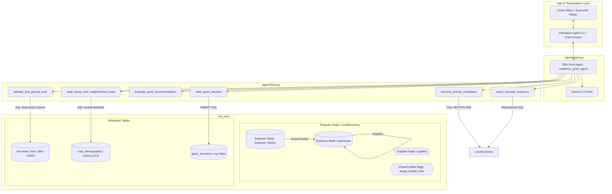

# Architecture Specification: Local Economy Resilience Agent
**Corridor**: San Francisco — Central Market  
**Track**: Micro-Producer & Supply Continuity  
**Target Dataset**: `qwiklabs-gcp-03-14e29f4c8c1f.a4i_econ`  
**Framework**: Google Agent Development Kit (ADK) & BigQuery Property Graphs (GQL)

---

## 1. Executive Summary & Design Premise

The **Local Economy Resilience Agent** acts as an AI Economic Development & Resilience Grant Officer. Rather than relying on simple subjective need or single-hop intuition, the agent identifies high-leverage micro-producers whose disruption would cascade through neighborhood storefronts.

### Core Axioms
1. **"A graph makes consequence visible; it does not make the decision."**
2. **Prioritization, not Prediction**: The agent prioritizes *"who to investigate first and why"*, explicitly accounting for unobserved contracts, cash reserves, and inventory buffers.
3. **Guard Against Circularity**: Historical loan charge-offs serve strictly as an out-of-sample ground-truth validator; they are never fed into the topological grant sizing calculation.
4. **Resilience Sweet Spot (5–25 Exposed)**: Mitigates giant hub bias (ubiquitous broadline vendors >25 connections that are readily substitutable) and trivial leaves (<5 connections).

---

## 2. System Architecture Diagram



---

## 3. Data Tier: Provenance & Reality Matrix

| Table / Layer | Type / Graph Role | Ground Truth Status | Schema & Key Fields | Purpose & Caveats |
|---|---|---|---|---|
| **`businesses`** | Node (`Business`) | **100% Real** (SF Registered Open Data) | `business_id` (PK), `name`, `naics4`, `address`, `zip`, `latitude`, `longitude` | 231 filtered commercial nodes in Central Market across 65 NAICS4 codes. |
| **`employer_blocks`** | Node (`Employer`) | **Real** job counts, approximate tract | `block_id` (PK), `tract`, `jobs` | 122 daytime employment blocks generating foot traffic demand. |
| **`supplies`** | Edge (`Supplies`) | **Modeled** (BEA Input-Output coefficients + distance <=1200m) | `edge_id` (PK), `supplier_id` $\rightarrow$ `buyer_id`, `intensity`, `metres` | 989 directed edges. Capped at top 5 suppliers per buyer; drops 21 ubiquitous input sectors. |
| **`draws_footfall_from`** | Edge (`DrawsFootfall`) | **Modeled** (Commuter worker allocation) | `edge_id` (PK), `block_id` $\rightarrow$ `business_id`, `worker_share`, `metres` | 1,024 edges allocating LEHD daytime workers to walkable consumer establishments. |
| **`borrowed_from`** | Attribute (SQL Join) | **100% Real** (SBA FOIA 7(a)/504) | `business_id`, `bank_name`, `gross_approval`, `loan_status`, `charged_off` | **Validation Only**. 4 loans across 3 Central Market businesses (0 charged off). Non-circular validator. |
| **`tract_demographics`** | Attribute (SQL Join) | **100% Real** (Census ACS 5-Year) | `geo_id` (PK), `poverty_rate`, `no_vehicle_rate` | Spatial equity audit comparing applicant tracts to corridor averages. |

---

## 4. Property Graph Specification (`LocalEconomy`)

Defined in `create_graph.sql` and registered under the BigQuery Enterprise reservation:

```sql
CREATE OR REPLACE PROPERTY GRAPH a4i_econ.LocalEconomy
  NODE TABLES (
    a4i_econ.businesses
      KEY (business_id)
      LABEL Business PROPERTIES (business_id, name, address, zip, naics4, latitude, longitude),
    a4i_econ.employer_blocks
      KEY (block_id)
      LABEL Employer PROPERTIES (block_id, tract, jobs)
  )
  EDGE TABLES (
    a4i_econ.supplies
      KEY (edge_id)
      SOURCE KEY (supplier_id) REFERENCES businesses (business_id)
      DESTINATION KEY (buyer_id) REFERENCES businesses (business_id)
      LABEL Supplies PROPERTIES (intensity, metres),
    a4i_econ.draws_footfall_from
      KEY (edge_id)
      SOURCE KEY (block_id) REFERENCES employer_blocks (block_id)
      DESTINATION KEY (business_id) REFERENCES businesses (business_id)
      LABEL DrawsFootfall PROPERTIES (worker_share, metres)
  );
```

---

## 5. Agent Tool Interfaces & Algorithmic Mechanics

### Tool 1: `discover_priority_candidates`
* **GQL Mechanism**:
  ```sql
  GRAPH a4i_econ.LocalEconomy
  MATCH (seed:Business)-[:Supplies]->{1,2}(exposed:Business)
  RETURN seed.business_id AS business_id, seed.name AS business, seed.naics4 AS industry,
         COUNT(DISTINCT exposed.business_id) AS exposed_2hop
  NEXT
  FILTER exposed_2hop >= @min_exposed AND exposed_2hop <= @max_exposed
  RETURN business_id, business, industry, exposed_2hop
  ORDER BY exposed_2hop DESC
  ```
* **Sole-Source Filter**: Cross-checks total registrants in the applicant's `naics4` across Central Market. If `count == 1`, tags the candidate with a sole-source caveat (buyers could potentially source outside the corridor).

### Tool 2: `query_cascade_exposure`
* **Bidirectional Traversal**:
  * **Forward (Downstream Protection)**: `(seed)-[:Supplies]->{1,2}(exposed:Business)` identifies vulnerable downstream buyers.
  * **Backward (Customer Reliance)**: `(buyer:Business)-[:Supplies]->(seed)` identifies direct customer concentration and demand risk.
* **Path Serialization**: Employs `TO_JSON(p) AS path_json` with `ANY SHORTEST` paths to remain below visualizer payload limits.

### Tool 3: `evaluate_grant_recommendation`
* **Scoring Rules**:
  * `exposed == 0`: $0 grant (Priority LOW).
  * `5 <= exposed <= 25` (Sweet Spot): Recommends up to 25% of fund budget ($10,000–$12,500) (Priority HIGH).
  * `exposed > 25` (Hub Trap): Recommends capped allocation ($7,500) (Priority MEDIUM) with hub substitutability warning.
* **Non-Circularity**: Sizing is strictly determined by network topology and customer diversification, avoiding charge-off contamination.

### Tool 4: `validate_sba_ground_truth`
* **Direct Match**: Flags if an applicant has a ground-truth loan or active default in `borrowed_from`.
* **Statewide Seasoned Benchmark Rollup**:
  * Evaluates loans seasoned $\ge 2$ years to account for vintage lag.
  * Minimum threshold: $N \ge 30$.
  * Rollup sequence: `CA_NAICS4` $\rightarrow$ `CA_NAICS2_ROLLUP` if $N < 30$.
* **Disclosures**: Explicitly tags metric as an *"SBA Industry Credit Benchmark"* rather than total business failure rate.

### Tool 5: `audit_equity_and_neighborhood_need`
* **Mechanism**: Compares applicant census tract poverty rate against the Central Market corridor mean.
* **Audit Mandate**: Evaluates whether funding reaches high-need tracts or simply follows edge-generator density.

### Tool 6: `write_grant_decision`
* **Mechanism**: Creates `a4i_econ.grant_decisions` (if missing) and logs structured decision memos, timestamps, amounts, and audit rationale.

---

## 6. End-to-End Triage & Audit Lifecycle

```mermaid
sequenceDiagram
    autonumber
    actor Officer as Grant Officer
    participant Agent as ADK Agent
    participant Graph as BigQuery GQL
    participant SQL as BigQuery SQL

    Officer->>Agent: "Identify top Central Market micro-producers for our $50k fund"
    Agent->>Graph: discover_priority_candidates(min=5, max=25, industry_prefix='31-33')
    Graph-->>Agent: Candidates (e.g. Cumaica Coffee, Sour Flour) + sole-source flags
    Officer->>Agent: "Evaluate Sour Flour"
    Agent->>Graph: query_cascade_exposure(business_id)
    Graph-->>Agent: Forward cascade (14 exposed) + Backward buyers (6 direct)
    Agent->>SQL: validate_sba_ground_truth(business_id, naics4)
    SQL-->>Agent: Direct match: None; Seasoned Benchmark: CA_NAICS4 (N=412, CO_Rate=4.2%)
    Agent->>SQL: audit_equity_and_neighborhood_need(business_id)
    SQL-->>Agent: Tract 012402 (Poverty: 24.8% vs Corridor Avg: 21.6% -> High Need)
    Agent->>Agent: evaluate_grant_recommendation(exposed=14, buyers=6)
    Agent->>Officer: Formats Audit-Ready Grant Memo with Model Disclosures
    Officer->>Agent: "Approve recommendation"
    Agent->>SQL: write_grant_decision(...)
    SQL-->>Officer: Decision recorded with decision_id
```

---

## 7. Known Information Gaps & Audit Caveats

Every memo and presentation deck generated under this architecture explicitly notes:
1. **Unobserved Contracts**: BEA supply links model industry propensity, not signed commercial supplier contracts.
2. **Buffer Inventory**: Operational shelf life and backup supplier access remain unobserved.
3. **Cash Reserves**: Balance sheet liquidity is unobserved outside of SBA loan histories.
4. **Coverage Bounds**: Ground-truth SBA loan matches exist for ~10% of corridor establishments; benchmark rates provide macro credit context.
